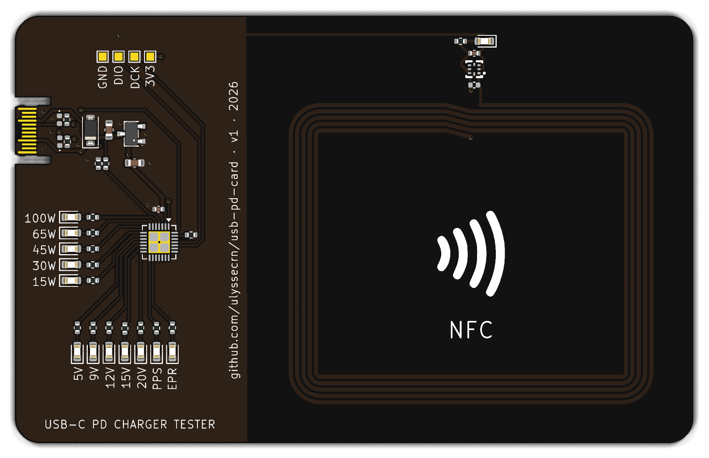
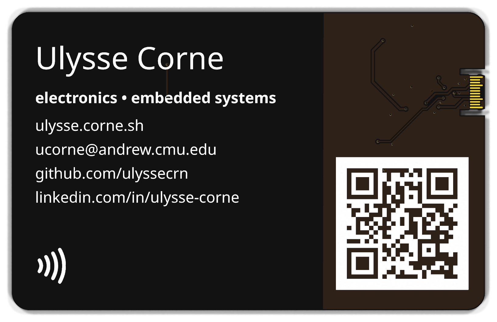

# usb-pd-card

A credit-card-sized PCB business card that is also a **USB-C PD charger tester** and a **battery-free NFC tag**.

## What it does
- **USB-C PD tester:** plug any USB-C charger or cable into the card edge.
  - The CH32X035 MCU reads the charger's advertised capabilities and lights one LED each for 5 V / 9 V / 12 V / 15 V / 20 V / PPS / EPR.
  - A 5-LED bar shows max power: 15, 30, 45, 65, 100 W.
  - It only ever asks the charger for 5 V.
- **NFC:** tap a phone on the coil and it opens [ulysse.corne.sh](https://ulysse.corne.sh). No battery: the NT3H2111 tag and its LED run on energy harvested from the phone's field.

## Hardware
| | |
|---|---|
| Board | 85.6 × 54 mm (ID-1), 0.6 mm FR4, 2 layers, ENIG, matte black mask |
| USB-C | PCB-edge paddle, tongue cut into the board; CC1/CC2 with 5.1 kΩ Rd + ESD |
| MCU | WCH CH32X035G8U6 (RISC-V, built-in USB PD PHY) |
| Power | ME6228 3.3 V LDO from VBUS, SMF20A TVS |
| NFC | NXP NT3H2111 + on-board 5-turn coil (≈ 2.3 µH estimated) |
| Assembly | JLCPCB PCBA, all parts on the front |

## Repo layout
- `usb-pd-card.kicad_*`: KiCad 10 project (schematic + PCB)
- `lib/`: project symbols and footprints (USB-C paddle derived from [flip-card](https://github.com/Nicholas-L-Johnson/flip-card), MIT)
- `lib/nfc-coils.pretty/`: generated NFC coil footprints
- `tools/nfc_coil.py`: coil generator and inductance estimator (plain Python, no dependencies). Try `python3 tools/nfc_coil.py selftest`.
- `jlcpcb/`: v1 production files (Gerbers, BOM, CPL)
- `AGENTS.md`: full design notes, pin map and decisions

## Status
v1 hardware design is done (tag `v1`). Firmware and bring-up are next.
